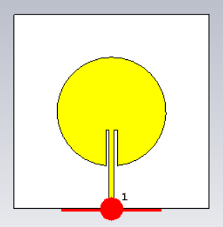
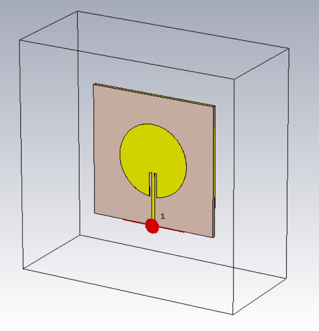
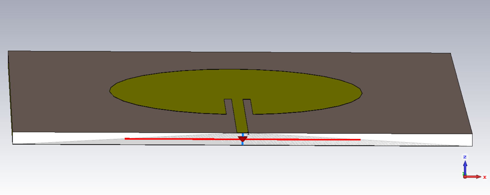
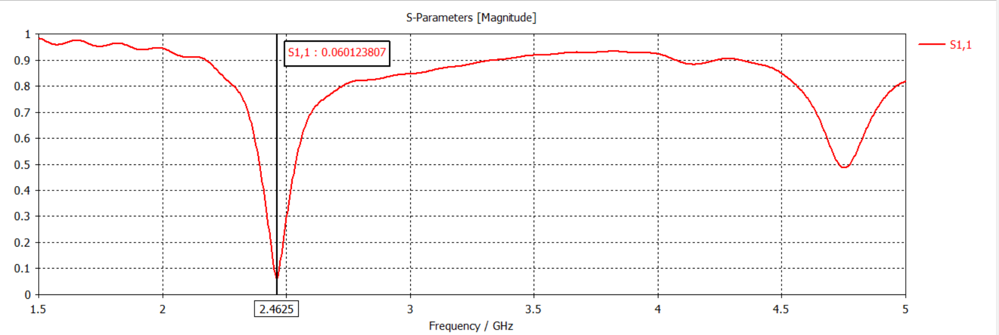
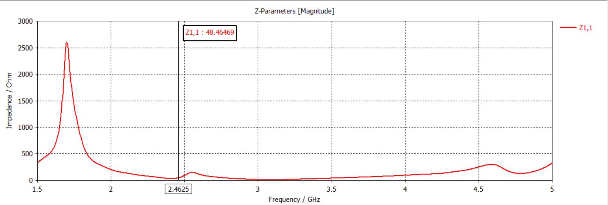
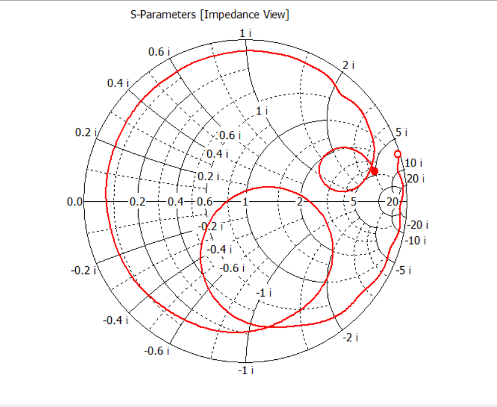
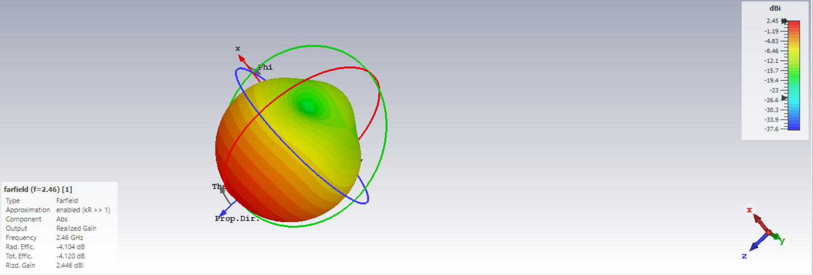

# 2.45 GHz Parametric Inset-Fed Circular Patch Antenna Design

This repository contains the complete design, parametric optimization, and electromagnetic simulation of an inset-fed circular microstrip patch antenna. The structure is optimized to operate within the 2.45 GHz Industrial, Scientific, and Medical (ISM) band, commonly utilized for Wi-Fi, Bluetooth, and IoT applications. The project was designed and simulated using the Time Domain Solver in CST Studio Suite.

---

## Antenna Structure and Model

### Geometrical Parameters
The antenna geometry is fully parametric. The dimensions automatically scale dynamically when the baseline variables are updated in the parameter list.

| Parameter Name | Description | Value |
| :--- | :--- | :--- |
| **a** | Radius of the circular patch | 16.8 mm |
| **w** | Total width of the ground plane and substrate | 60.0 mm |
| **l** | Total length of the ground plane and substrate | 60.0 mm |
| **wf** | Width of the empty inset slot cutout | 3.25 mm |
| **f** | Width of the microstrip copper feed transmission line | 1.5 mm |

### Substrate and Material Properties
The layer stack-up consists of a ground plane, a dielectric substrate, and the patch conductor layer.

| Material Layer | Material Type | Dielectric Constant (Epsilon) | Thickness / Height (h) |
| :--- | :--- | :--- | :--- |
| **Radiating Patch** | Copper (annealed) | Lossy Conductor | 0.035 mm |
| **Dielectric Substrate**| FR-4 (lossy) | 4.3 | 1.6 mm |
| **Ground Plane** | Copper (annealed) | Lossy Conductor | 0.035 mm |

---
## Design

---
## Simulation Results

### 1. S-Parameters (S11 Magnitude)
The return loss curve demonstrates a sharp resonance dip centered at **2.4625 GHz**, reaching a minimum magnitude value of **-24.4 dB**.

### 2. Z-Parameters (Z11 Input Impedance Magnitude)
The absolute input impedance magnitude stabilizes at **48.46 Ohm** within the operational resonance window, providing an optimal match to a standard 50 Ohm transmission network.

### 3. Smith Chart (S11 Impedance View)
The impedance trajectory loops tightly near the center geometric coordinate (1.0, 0.0) of the chart, confirming the elimination of unwanted inductive and capacitive reactance.

### 4. 3D Farfield Absolute Radiation Pattern (Abs)
The 3D radiation plot shows a broadside directional lobe projecting outward from the top face of the circular patch along the Z-axis, yielding a maximum **Realized Gain of 2.446 dBi**.

---

## How to Use this Repository
1. Download or clone this repository to your machine.
2. Open **CST Studio Suite**.
3. Load the `Circular_Patch_Antenna_2.45GHz.cst` file.
4. If you wish to change the target bands, modify the radius parameter `a` in the **Parameter List**, press `F7` to rebuild, and run the Time Domain Solver.

---

## Technical Notes and Engineering Definitions

[^1]: **S11 (Return Loss) Interpretations:** 
    S11 measures the ratio of power reflected backward toward the signal source relative to the power entering the antenna.
    *   **0 dB:** 100% of the injected power is reflected back. The antenna functions as a perfect electrical mirror and does not radiate.
    *   **-10 dB:** The mandatory industry baseline threshold. This signifies that 10% of the input power is reflected back, while 90% is accepted by the structure to be radiated.
    *   **-20 dB:** A high-efficiency engineering standard. At this level, only 1% of the power is reflected back, meaning 99% is cleanly accepted. This design achieved **-24.4 dB**, ensuring a **99.64% power transfer efficiency**.

[^2]: **Mesh Settings and Numerical Optimization:** 
    To execute this complex full-wave simulation on hardware constrained to 8GB of RAM, the mesh density was intentionally optimized. A Hexahedral mesh type was selected with the cell density bounded at 12 cells per maximum model wavelength. This setting generated a total of **216,384 mesh cells**. Keeping the cell count below the 300,000 threshold allows the matrix equations to solve efficiently within consumer-grade hardware limits without running out of RAM or sacrificing boundary accuracy around the narrow inset feed line gaps.

[^3]: **Step-by-Step Antenna Design Procedure:**
    1. **Analytical Calculation:** The starting radius of the circular patch was calculated using the cavity model equations based on the operational frequency (2.45 GHz), substrate dielectric constant (4.3), and substrate height (1.6 mm). 
    2. **Frequency Correction:** Initial testing at a standard 10 mm radius placed the resonance peak near 4.15 GHz. Using an inverse frequency scaling ratio (a_new = a_old * [f_old / f_target]), the radius was expanded to **16.8 mm** to shift the operating mode down to the 2.45 GHz spectrum.
    3. **Substrate Resizing:** The rectangular substrate and ground plane lengths were expanded from 50 mm to **60 mm** to accommodate the larger patch radius and preserve the minimum 6h fringing field boundary clearance.
    4. **Impedance Matching:** The microstrip feedline was routed into the circle via an inset slot layout. The penetrative length was parametrically bound via the expression `-a/3` to reach the zero-reactance locus under the patch.
    5. **Port Normalization:** A 50 Ohm Discrete Face Port was applied vertically across the input edge of the microstrip line down to the ground plane, and software normalization was activated to verify real-world system compatibility.
